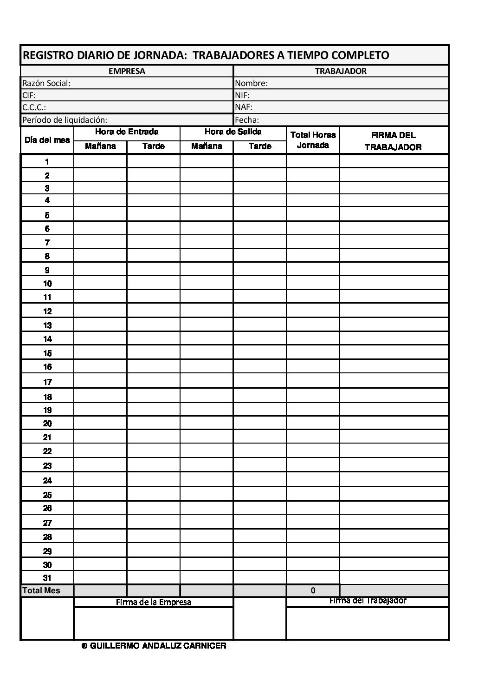

# Sistema de gestión de Jornada Laboral para empresa de sector de la Construcción

## Miembros del grupo L2 - GRUPO 3

1. Barrera Lozano, Cayetano
2. Ragel Ruiz, Luca
3. García Félix, Alejandro

## 1. Introducción al problema

Nuestro cliente corresponde a una empresa la cual se dedica a la construcción, rehabilitación y reformas de infraestructuras por todo el territorio español. Una de las muchas labores que se llevan a cabo en dicha empresa es el control en cuanto al registro de jornada laboral.

Actualmente el cliente lleva a cabo el registro de la jornada laboral manualmente mediante partes de trabajo "a papel", donde el responsable de cada obra escribe a mano las horas de entrada y salida de cada Trabajador para posteriormente enviarlas al responsable que se encuentra en las oficinas de la empresa. En la siguiente imagen observamos la plantilla que se va rellenando diariamente:

Sin embargo, en cuanto a este método utilizado, encuentran varios inconvenientes, entre ellos los siguientes:

- En España, el registro de la jornada laboral está regulado en el artículo 34.9 del Estatuto de los Trabajadores (introducido por el [Real Decreto-ley 8/2019](https://www.boe.es/eli/es/rdl/2019/03/08/8/con)) y es de obligatorio cumplimiento para todas las empresas, con independencia de su tamaño o sector.
El Ministerio de Trabajo mantiene en tramitación un proyecto de Real Decreto de Registro de Jornada Digital. Cuando este texto definitivo se apruebe y se publique en el Boletín Oficial del Estado (BOE). El formato físico (papel y plantillas manuales) quedará expresamente prohibido y se exigirá obligatoriamente que el sistema sea electrónico o digital, garantizando la inmutabilidad de los datos (que no se puedan borrar ni alterar los fichajes sin dejar una huella/auditoría clara).

- El Personal de Oficina debe esperar a que los responsables de cada obra envíen los partes por medio de fotos, lo que a menudo provoca retrasos.

- Han ocurrido algunos incidentes que involucran las pérdidas de dichos partes con sus correspondientes sanciones económicas, así como las dificultades del Personal de Oficina para calcular el salario mensual de los Trabajadores afectados.

- Los propios Trabajadores que necesitan firmar el parte de forma diaria encuentran incómodo el hecho de tener que desplazarse hasta la garita donde se ubica dicho registro de firma, perdiendo tiempo que podría ser dedicado al desarrollo de sus funciones laborales.

Ante estos inconvenientes, el cliente solicita un software que permita gestionar de manera digital la creación y gestión de partes de trabajo cumpliendo la normativa vigente y permitiendo fácil adaptación a futuras normativas o cambios de la ley. Además, el cliente busca que sea escalable, permitiendo de forma sencilla para los responsables poder gestionar un mayor número de proyectos a futuro e incorporación de nuevos Trabajadores sin necesidad de consumir una gran cantidad de tiempo.

Por otro lado, se exige una forma en la que los propios Trabajadores, de forma independiente, puedan registrar de forma intuitiva y sencilla sus correspondientes detalles de parte.

## 2. Glosario de términos

- Detalle de parte: entrada (fila), correspondiente a un Trabajador y parte de trabajo concreto, que incluye su registro de jornada (hora de entrada y salida, actividades realizadas, notas del Trabajador e incidencias)
- Incidencia: registro asignado a un detalle de parte que se utiliza para referirse a un suceso importante que afecta al correcto desarrollo de la jornada o proyecto.
- Tipo de pago: propiedad de un Trabajador que indica la forma de percibir su pago mensual. Tipos disponibles:
    - Por administración: se calcula el total de horas trabajadas a lo largo del mes, y su líquido a percibir a partir de ese dato y un coste por hora que tiene asociado el Trabajador.
    - Por jornada: se calcula el total de días que ha asistido el Trabajador a un proyecto, independientemente del tiempo que haya durado su jornada.
    - Por producción: se calcula a partir del número de unidades producidas por el Trabajador (por ejemplo: m², unidades de obra o piezas, etc.) 
- Parte de trabajo: registro (tabla) en el sistema que pertenece a un día concreto y un proyecto (obra), el cual consta de uno o varios detalles de parte.
- Proyecto (obra): registro en el sistema que hace referencia a una construcción en la que la empresa está trabajando.

## 3. Visión general del sistema

### 3.1. Requisitos generales

Creación de partes automáticamente: todos los días a las 00:00 se creará un **Parte de trabajo** para cada **Proyecto**. Tendrá asignado los mismos trabajadores del día anterior, y el Encargado puede modificarlo más tarde.

Registro de horas de entrada y salida; y notas: los Trabajadores con su dispositivo deben poder acceder al sistema para colocar la hora en la que inician y terminan la jornada, así como comentarios adicionales que quieran añadir.

Control de **Incidencias**: los Encargados y Personal de Oficina (Administradores) pueden crear y visualizar **Incidencias** asociadas a un **Parte de trabajo** concreto, así como los Trabajadores asociados a dicha **Incidencia** (si los hubiera).

Visualización de partes: el Personal de Oficina debe poder ver de manera centralizada todos los **Partes de trabajo**, incluyendo el del día actual, mediante una interfaz que incorpore filtros.

Exportación de partes: el Personal de Oficina debe poder exportar los datos de los **Partes de trabajo** que pueden visualizar a formato de Hoja de Cálculo.

### 3.2. Usuarios del sistema

El cliente, al corresponder a una empresa privada, exige un software cuyo uso sea privado de forma que solo puedan tener acceso al software solo aquellos usuarios que hayan sido registrados previamente, y recibido un usuario y una contraseña concreta para poder acceder a esta (Trabajadores / miembros de la empresa). Por ende, los usuarios que harán uso de la aplicación se clasifican en:

- Administrador: rol otorgado a los jefes y Personal de Oficina, los cuales tendrán acceso a toda la información y permisos del sistema, de forma que dicho Personal de Oficina pueda desempeñar sus labores almacenando y comprobando todos los **Partes de trabajo** del día correspondiente.

- Encargado: personal reducido de la empresa el cual tiene un papel fundamental en un determinado **Proyecto**. Cada Encargado tiene asociado un **Proyecto** concreto y desempeñará labores relacionadas con el control de la situación en la obra y asegurarse del correcto desempeño de las labores por parte de los Trabajadores. Asimismo, atender contratiempos o incidentes que puedan suceder en el proceso de las mismas.

- Trabajador: menor cargo asociado a la empresa al cual pertenecen la mayoría de miembros de esta. Cada uno de estos se encarga de una determinada especialidad en la obra y pueden estar organizados en grupos de modo que cada equipo contará con un líder que asimismo será otro Trabajador el cual responderá ante cualquier suceso relacionado con el mismo. Estos Trabajadores serán los que tendrán asociados unos determinados **Detalles de parte** ya mencionados en el glosario de términos.

## 4. Catálogo de requisitos

### 4.1. Requisitos funcionales

#### R.F.01. Acceso al listado de partes de trabajo 

Como Encargado, quiero poder acceder a los partes de trabajo asociados al **Proyecto** del cual soy Encargado.

**Prueba de aceptación**

- Si selecciono un **Parte de trabajo** de un **Proyecto** del que soy Encargado, puedo ver en tiempo real los datos que van añadiendo los Trabajadores.
- En el apartado de **Partes de trabajo**, no deben aparecer aquellos cuyo **Proyecto** no soy Encargado. Aun así, si intento acceder a uno al cual no tengo permiso, el sistema debe impedírmelo y devolverme un error.
- Se debe aplicar la regla de negocio R.N.08

#### R.F.02. Vista de los partes de trabajo con filtros

Como Personal de Oficina/Administrador quiero que los **Partes de trabajo** se puedan ver de manera unificada con tres filtros (por **Proyecto**, por Trabajador y por fecha) con el objetivo de que en el  caso de tener que presentar dicha información ante una inspección o tener que calcular la nómina de los Trabajadores pueda hacerlo de forma rápida y efectiva. Además, en el caso de filtrar solo por un Trabajador, quiero poder acceder a todos los **Detalles del parte** asociados a ese Trabajador en los distintos **Proyectos** en los que haya participado en el mes en el que nos encontramos.

**Prueba de aceptación**
- Si en el apartado de **Partes de trabajo** almacenados, filtro por el nombre de un Trabajador concreto obtengo únicamente sus registros asociados a dicho mes en cualquier **Proyecto**.
- Si aplico un filtro incorrecto (un mes del que no hay datos o posterior al actual), obtengo un mensaje que indique la inexistencia de registros asociados a dicho filtro.

#### R.F.03. Registro de entrada y salida

Como Trabajador quiero poder registrar mi hora de entrada y de salida (**Detalle de parte**) para justificar mi asistencia y tiempo de trabajo, en el **Parte de trabajo** correspondiente.

**Prueba de aceptación**
- Si al intentar firmar me encuentro en la ubicación de la obra, entonces el sistema me lo permite.
- Si al intentar firmar no me encuentro en la ubicación de la obra, el sistema no me permite registrarme.
- Se debe aplicar la regla de negocio R.N.01
- Se debe aplicar la regla de negocio R.N.02
- Se debe aplicar la regla de negocio R.N.03
- Se debe aplicar la regla de negocio R.N.04

#### R.F.04. Anotaciones en el parte de trabajo

Como Trabajador quiero poder, opcionalmente, añadir anotaciones en el **Detalle de parte** para añadir cualquier comentario y que pueda ser visto por el Personal de Oficina o el Encargado.

**Prueba de aceptación**
- Si pongo algún texto en el apartado de anotaciones lo debe de poder ver el Personal de Oficina y el Encargado.
- Si no pongo nada en el apartado de anotaciones, el Personal de Oficina y el Encargado verán el campo vacío.

#### R.F.05. Asignación de tareas realizadas

Como Encargado, quiero poder asignarle únicamente a aquellos Trabajadores cuyo **Tipo de pago*** sea **Por Producción**, cuál ha sido su tarea desempeñada a lo largo de la jornada.

**Prueba de aceptación**
- Si el **Tipo de pago*** de un Trabajador es **Por Producción** debo de poder asignarle cuál ha sido su tarea desempeñada a lo largo de la jornada.
- Si el **Tipo de pago*** de un Trabajador no es **Por Producción** no me debe salir la opción de asignarles la tarea desempeñada.
- Se debe aplicar la regla de negocio R.N.05

#### R.F.06. Creación de incidencias

Como Encargado quiero poder, opcionalmente, crear **Incidencias** asociadas a un **Parte de trabajo** para llevar un registro de los eventos inesperados que afectan al normal desarrollo del **Proyecto**, y, opcionalmente, poder asociarlas a uno o varios Trabajadores.

**Prueba de aceptación**
- Si creo una **Incidencia**, el Personal de Oficina debe poder ver la **Incidencia** y los Trabajadores asociados a ella (si los hubiera).
- Si creo una **Incidencia**, debe no ser visible para otro tipo de personal ajeno al especificado anteriormente.
- Se debe aplicar la regla de negocio R.N.06

#### R.F.07. Modificación de partes

Como Administrador quiero poder modificar cualquier **Parte de trabajo**, tanto de días anteriores como los del día actual, para corregir errores si los hubiera.

**Prueba de aceptación**
- Si en el apartado de **Partes de trabajo** almacenados entro en un **Parte de trabajo**, debo tener una opción de poder editar la información del mismo.
- Si no soy Administrador, no debo de tener permisos para acceder a la sección de **Partes de trabajo** almacenados.
- Se debe aplicar la regla de negocio R.N.02

#### R.F.08. Exportación de datos a formato estándar HOJA DE CÁLCULO

Como Encargado de la oficina quiero poder, una vez aplicados los filtros que me interesen, cuente con un botón el cual me permita poder exportar dicha información a formato hoja de cálculo permitiéndome de forma efectiva realizar cálculos asociados a los Trabajadores.

**Prueba de aceptación**
- Si soy Administrador, en la sección de **Partes de trabajo** almacenados debo tener una opción para exportar los datos seleccionados como hoja de cálculo.
- Si no soy Administrador no debo tener permisos para acceder a la sección de **Partes de trabajo** almacenados y por tanto no puedo exportarlos.

#### R.F.09. Consulta del historial de jornadas del Trabajador

Como Trabajador, quiero poder consultar el historial de mis **Detalles de parte** de jornadas anteriores, incluyendo las horas de entrada y salida, las anotaciones y las actividades asignadas, para comprobar las jornadas que he realizado y detectar posibles errores en mis registros.

**Pruebas de aceptación**
- Si accedo al historial de jornadas, puedo consultar mis **Detalles de parte** de días anteriores, incluyendo las horas registradas y las anotaciones correspondientes.
- Si intento consultar los **Detalles de parte** de otro Trabajador, el sistema me deniega el acceso.

#### R.F.10. Consulta de información del proyecto

Como Encargado, quiero poder consultar la información del proyecto que tengo asignado, incluyendo su ubicación, estado y equipos asociados, para conocer la situación de la obra que gestiono.

**Pruebas de aceptación**
- Si accedo a la información de mi proyecto asignado, puedo consultar su ubicación, estado y equipos asociados.
- Si intento consultar la información de un proyecto que no tengo asignado, el sistema me deniega el acceso.

#### 4.1.1. Requisitos de información

##### R.I.01. Creación de usuarios

Como Administrador quiero que se pueda crear usuarios en el sistema de un tipo determinado (Administrador, Encargado o Trabajador) para dar acceso al sistema a el personal de la empresa. Estos deben contener el nombre completo, un email y una contraseña; y el DNI. Asimismo, el Trabajador debe tener atributos adicionales: número de seguridad social y especialidad. Los Encargados deben tener además almacenado su teléfono corporativo. El Personal de Oficina no tiene ningún atributo propio.

##### R.I.02. Creación de equipos

Como personal de oficina, necesito que los Trabajadores puedan agruparse formando equipos de modo que a la hora de poder asociarles incentivos o el pago asociado a su producción, este pueda ir destinado al propio equipo. Esto también beneficia a lo hora de adjudicarles un vehículo de empresa. Un equipo, por ende, cuenta con un conjunto de Trabajadores y un vehículo asociado, identificado por su matrícula.

##### R.I.03. Creación de proyectos

Como Administrador, quiero poder crear, gestionar y eliminar **Proyectos** en los que esté trabajando la empresa. Estos **Proyectos** deben tener un nombre, una ubicación y un estado, que puede ser activo, pausado o finalizado. Un **Proyecto** debe tener un Encargado que será el que gestionará el **Proyecto** mientras esté activo, además de uno o varios equipos que serán los que trabajarán en el **Proyecto**. Además, un **Proyecto** tiene asociado un **Parte de trabajo** por cada día que el **Proyecto** haya estado activo.

##### R.I.04. Creación de incidencias

Como Encargado, quiero poder crear **Incidencias** en caso de que ocurra algo inesperado que influya en el normal desarrollo del **Proyecto**. El **Parte de trabajo** tiene una descripción de la **Incidencia** y la hora a la que ocurrió. Las **Incidencias** van relacionadas con el **Parte de trabajo** del día en el que haya ocurrido la **Incidencia**. Además, si hay algún Trabajador involucrado en la **Incidencia** me gustaría poder relacionarlo con la **Incidencia**.

##### R.I.05. Creación de partes

Como Administrador, necesito que para cada uno de los **Proyectos** con los que cuento, de forma diaria, cuente con un **Parte de trabajo** de registro diario asociado a cada una de estas obras. Estos partes cuentan con una fecha, además, cada uno de estos partes cuenta con un número de Trabajadores asociados los cuales cuentan con sus propios **Detalles de parte** y además, tendrán asociados unas **Incidencias** que se registrarán de forma diaria con el fin de tener un control diario de todos mis **Proyectos**. 

##### R.I.06. Registro de auditorías
Como Administrador, necesito que el sistema registre de forma automática un historial de auditoría para cada acción realizada sobre los partes de trabajo diarios y sus detalles asociados. Este registro debe activarse cada vez que un **Parte de trabajo** o un **Detalle de parte** sea creado, modificado o eliminado, con el fin de garantizar la seguridad y trazabilidad de los datos de las obras. Cada uno de estos registros cuenta con un identificador de usuario, fecha y hora concreta y tipo de operación.

##### R.I.07. Creación de detalles de parte
Como Trabajador, necesito poder registrar los detalles asociados a mí como Trabajador de forma que estos se incluyan en el parte. Necesito poder incluir la hora de entrada y salida en el turno de mañana y de igual forma con el turno de tarde. Por otro lado, necesito poder incluir anotaciones para añadir comentarios y por último, los Encargados necesitan poder asociarme una actividad en caso de que el **Tipo de pago** sea **Por producción**.

#### 4.1.2. Reglas de negocio

##### R.N.01. Turnos de trabajo
Cada Trabajador tiene asignado un turno (Mañana 7:00 - 15:00 o Tarde 17:00 - 22:00) y no puede registrar una hora de llegada anterior a la del inicio del turno, pero sí posterior a la de fin de turno.

**Prueba de aceptación**
- Como Trabajador, no debo poder registrar una hora de llegada anterior a la de inicio de mi turno.
- Como Trabajador, debo poder registrar una hora de llegada igual o posterior a la de inicio de mi turno.

##### R.N.02. Modificación de los datos
La hora de entrada y salida no puede ser modificada ni por el Encargado ni por el Trabajador. En caso de error, se debe avisar al Encargado para que contacte con el Personal de Oficina, quienes sí pueden modificar estos campos.

**Prueba de aceptación**
- Como Trabajador, accedo a los **Detalles de parte** asociados a mí pero una vez se inserta la hora de llegada, me salta un error al intentar modificarla.
- Como Administrador del sistema, puedo acceder a un **Parte de trabajo** concreto y modifico la fecha que ha sido introducida de forma errónea.

##### R.N.03. Ubicación a la hora de registrar la jornada
Los Trabajadores deben activar la ubicación de su dispositivo a la hora de registrar su jornada, si se encuentran en un rango de 250 metros respecto a la ubicación del **Proyecto**, pueden continuar con la acción; en caso contrario no.

**Prueba de aceptación**
- Como Trabajador, intento registrar mi hora de llegada estando a unos 300 metros de la zona de la obra, obteniendo un error que me indica la imposibilidad de realizar esta acción.
- Como Trabajador, me encuentro a 100 metros de la obra, pudiendo registrar mi jornada.

##### R.N.04. Jornadas diarias por Trabajador
Los Trabajadores solo pueden registrar una jornada en un día concreto. No pueden estar en dos **Proyectos** distintos en el mismo día.

**Prueba de aceptación**
- Como Trabajador, intento registrar una jornada en dos **Proyectos** distintos en el mismo día, obteniendo un error que me indica la imposibilidad de registrarme en dos **Proyectos** el mismo día.
- Como Trabajador, intento registrar una hora de inicio por primera vez en el día, el sistema me lo permite.

##### R.N.05. Registro de actividades
Los Encargados deben rellenar el atributo "actividades" solo de aquellos usuarios que tienen pago **Por Producción** y de ningún otro.

**Prueba de aceptación**
- Como Encargado, accedo a un Trabajador cuyo método de pago es **Por producción** y cuento con una casilla para poderle asociar una actividad concreta.
- Como Encargado, accedo a un Trabajador cuyo método de pago es **Por administración** y no cuento con ninguna casilla la cual pueda completar con su tarea desarrollada.

##### R.N.06. Creación de incidencias
Solo los Encargados deben poder crear **Incidencias**, y siempre relacionadas con el **Parte de trabajo** del día actual.

**Prueba de aceptación**
- Como Trabajador, no veo en la aplicación nada relacionado con las **Incidencias**.
- Como Encargado, puedo ver en la aplicación la opción de crear una **Incidencia** relacionada con el **Parte de trabajo** del día actual.

##### R.N.07. Asignación del Trabajador al proyecto
Un Trabajador solo puede registrar su jornada en un **Proyecto** si previamente ha sido asignado de manera activa a dicho **Proyecto** por parte del Administrador o Personal de Oficina para la fecha correspondiente.

**Prueba de aceptación**
- Como Trabajador, intento acceder a otro **Proyecto** el cual no me corresponde y recibo un mensaje de error indicando que ese **Proyecto** se me ha sido asignado aún.
- Como trabajador, puedo acceder a aquellos **Proyectos** a los que he sido asignado y poder registrar mi jornada.

##### R.N.8. Asignación y exclusividad de Encargados
Un **Proyecto** solo puede tener un Encargado principal asignado para una fecha dada. Un mismo Encargado no puede gestionar más de un **Proyecto** activo de manera simultánea en la misma jornada laboral.

**Prueba de aceptación**
- Como Encargado, no puedo acceder a más de un **Proyecto** por jornada. 
- Como Encargado, debo ver y gestionar un **Proyecto** por jornada.

### 4.2. Mapa de historias de usuario (opcional)

[Link](https://github.com/users/CayeOficial/projects/2/views/1)

### 4.3. Requisitos no funcionales (opcional)

**R.N.F. 01. Disponibilidad y 100% de tiempo de actividad**
Como dueño del sistema quiero que el sistema esté disponible durante las 24h del día, todos los días para el correcto funcionamiento de la administración.

**R.N.F. 02. Persistencia de datos**
Se debe garantizar que los datos están disponibles durante al menos 4 años, independientemente de si el Trabajador asociado a dichos datos sigue trabajando en la empresa.

**R.N.F. 03. Escalabilidad**
La base de datos y los demás servicios consultados deben estar preparados para escalarse horizontalmente en el caso de requerir una arquitectura con más espacio de almacenamiento.

**R.N.F. 04. Seguridad**
Como en el sistema se guardan datos sensibles (DNI, número de seguridad social), se debe garantizar que los datos están cifrados y protegidos ante ciberataques, así como que ningún personal ajeno a la empresa pueda acceder a ellos.

-- fin entregable 1 --

## 5. Modelo conceptual

### 5.1. Diagramas de clases UML

- con restricciones.

### 5.2. Escenarios de prueba

- con descripción textual y diagrama de objetos UML.

## 6. Matrices de trazabilidad

- Matriz de trazabilidad entre los elementos del modelo conceptual y los requisitos.

|       | EntidadX   | AsociaciónX  | RestricciónX  | Entidad2 ...   | 
|:------|:-----------|:-----------|:-----------|:-----------|
| RI-1  | X          | X          | X          | X          |
| RI-2  |            | X          |            | X          |
| RF-1  |            | X          |            | X          |
| RF-2  | X          |            | X          | X          |
| RN-1  |            | X          |            |            |
| RN-2  | X          | X          | X          |            |
| ...   |            |            |            |            |

-- fin entregable 2 --

## 7. Modelo relacional en 3FN

- Relaciones obtenidas al aplicar la transformación del modelo conceptual.

### 7.1.  Justificación de la estrategia de transformación de jerarquías

- si se identificaron jerarquías en el MC.

### 8. Matriz de trazabilidad MC/SQL (opcional):

- Restricciones sobre el MC / Elementos del modelo tecnológico (SQL) (Triggers, checks, etc.)
- Incluir Reglas de negocio — Constraints/Triggers en las matrices de trazabilidad para el entregable 3

|       | EntidadX   | AsociaciónX  | RestricciónX  | Entidad2 ...   | 
|:-------|:-------|:-------|:-------|:-------|
| TABLA-1 |        |        |        |        |
| TABLA-2 |        |        |        |        |
| TABLA-3 |        |        |        |        |
| TABLA-4 |        |        |        |        |
| TRIG-1 |        |        |        |        |
| TRIG-2 | X      | X      |        | X      |
| TRIG-3 |        | X      |        | X      |
| TRIG-4 |        |        | X      |        |
| CONST-1 |        |        |        |        |
| CONST-2 | X      | X      |        | X      |
| CONST-3 |        | X      |        | X      |
| CONST-4 |        |        | X      |        |

Se consideran todo tipo de constraints declarativas (aquellas definidas durante el CREATE TABLE).
-- fin entregable 3 --

## Referencias

